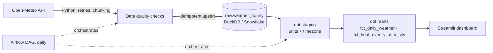

# Texas Weather Pipeline

An end-to-end batch data pipeline that ingests hourly weather history for six Texas cities from the [Open-Meteo](https://open-meteo.com/) archive API, loads it into a warehouse (DuckDB locally or Snowflake in the cloud), transforms it with dbt into tested analytics tables, runs daily on Airflow, and serves a Streamlit dashboard.



## What it demonstrates

| Concept | Where |
|---|---|
| API ingestion with retries, exponential backoff, rate limiting, and date chunking | `pipeline/extract.py` |
| Data quality gate (null keys, duplicates, out-of-range values, empty hours) | `pipeline/quality.py` |
| Idempotent loads (re-running never duplicates rows) via upsert / Snowflake `MERGE` | `pipeline/load.py` |
| Incremental ingestion using a per-city watermark, plus a run audit log | `pipeline/run.py`, `raw.pipeline_runs` |
| Layered dbt modeling: source → staging → marts, with a seed dimension | `dbt/models/` |
| Incremental dbt model with a 3-day lookback for late-arriving data | `fct_daily_weather.sql` |
| Gaps-and-islands SQL (consecutive 100°F+ days) | `fct_heat_events.sql` |
| 19 dbt data tests + source freshness checks | `schema.yml` files, `dbt/tests/` |
| Cross-warehouse SQL (DuckDB and Snowflake) via dbt macros | `dbt/macros/to_local_time.sql` |
| Orchestration with retries: extract → seed → freshness → build | `airflow/dags/weather_pipeline_dag.py` |
| 8 pytest unit tests (chunking, parsing, validation, idempotency, incremental runs) | `tests/` |

## Quick start (local, free)

```bash
python -m venv .venv && source .venv/bin/activate     # Windows: .venv\Scripts\activate
pip install -r requirements.txt

python -m pytest -q                                   # unit tests

python -m pipeline.run                                # first run backfills ~2 years for 6 cities
cd dbt
dbt seed  --profiles-dir .
dbt build --profiles-dir .                            # builds models + runs all tests
dbt source freshness --profiles-dir .
cd ..

streamlit run dashboard/app.py
```

Run `python -m pipeline.run` again later and it only pulls days newer than what's already loaded.

Useful options:

```bash
python -m pipeline.run --start 2024-01-01 --end 2024-12-31   # specific range
python -m pipeline.run --cities dallas irving                # subset of cities
```

Add a city by adding a row to `dbt/seeds/cities.csv`. The ingestion code and dbt both read from it.

## Running on Snowflake

1. Create a free trial at snowflake.com and a database named `WEATHER`.
2. `pip install -r requirements-snowflake.txt`
3. Copy `.env.example` to `.env`, fill it in, and export the variables (`set -a; source .env; set +a`).
4. Run:
   ```bash
   python -m pipeline.run --warehouse snowflake
   cd dbt && DBT_TARGET=prod dbt seed --profiles-dir . && DBT_TARGET=prod dbt build --profiles-dir .
   ```

## Running on Airflow

```bash
pip install "apache-airflow>=3.0"
export AIRFLOW__CORE__DAGS_FOLDER=$PWD/airflow/dags
export WEATHER_PROJECT_ROOT=$PWD
airflow standalone          # UI at http://localhost:8080, then trigger texas_weather_pipeline
```

Set `WEATHER_WAREHOUSE=snowflake` to have the DAG load into Snowflake and run dbt against the `prod` target.

## Data model

| Table | Grain | Notes |
|---|---|---|
| `raw.weather_hourly` | city × UTC hour | Primary key `(city_id, observed_at)` |
| `raw.pipeline_runs` | ingestion run | Rows extracted / rejected / loaded, status |
| `staging.stg_weather_hourly` | city × hour | °F, mph, inches, Central time |
| `marts.dim_city` | city | From the seed |
| `marts.fct_daily_weather` | city × local day | High/low/avg temp, rain, wind, humidity |
| `marts.fct_heat_events` | heat streak | Start, end, length, peak temperature |

## Design decisions

- **Why upsert instead of append?** The archive API fills in recent hours late. Re-pulling the last loaded day and upserting means corrections land without creating duplicates, and any run can be safely retried.
- **Why ingest in UTC?** UTC has no daylight-saving gaps, so the raw key stays unique. Conversion to Central time happens once in staging. That's also why daily rows have 23 or 25 hours on DST change days, which the tests allow for.
- **Why DuckDB and Snowflake?** DuckDB lets anyone run the whole project for free in seconds. The same code and dbt models run on Snowflake with only an environment change.
